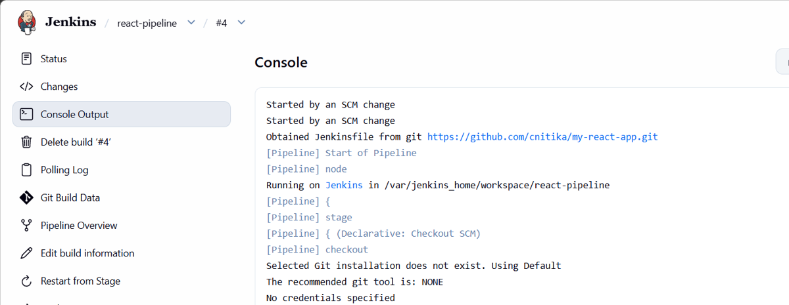
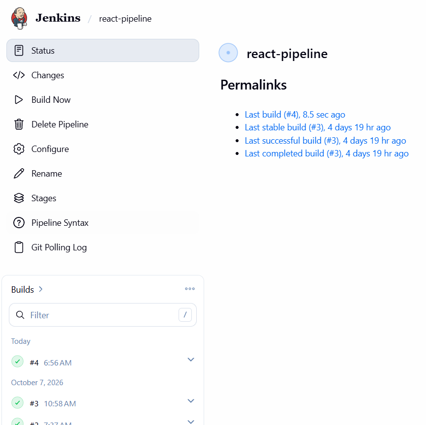
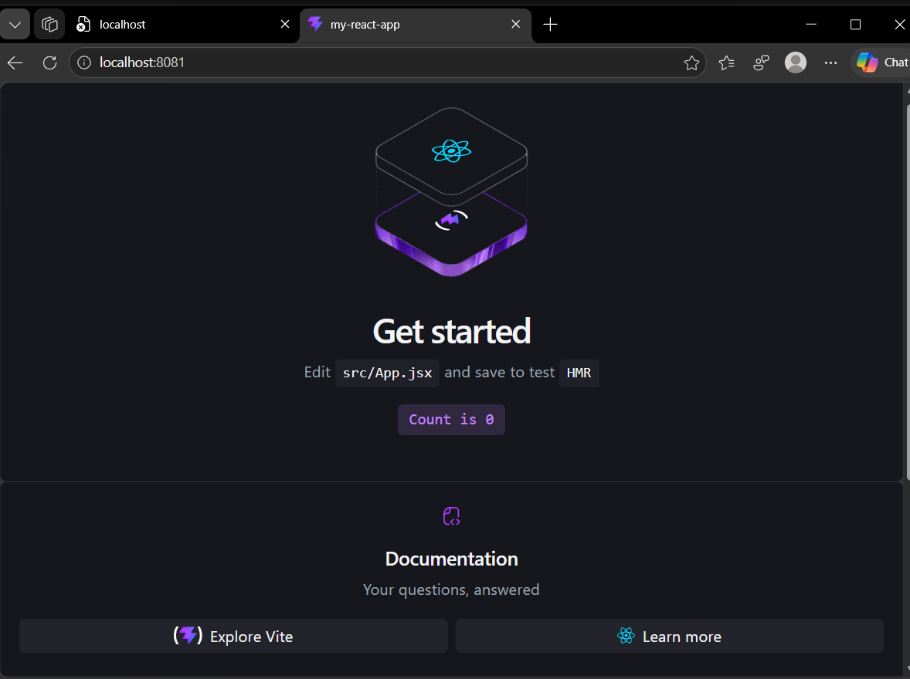
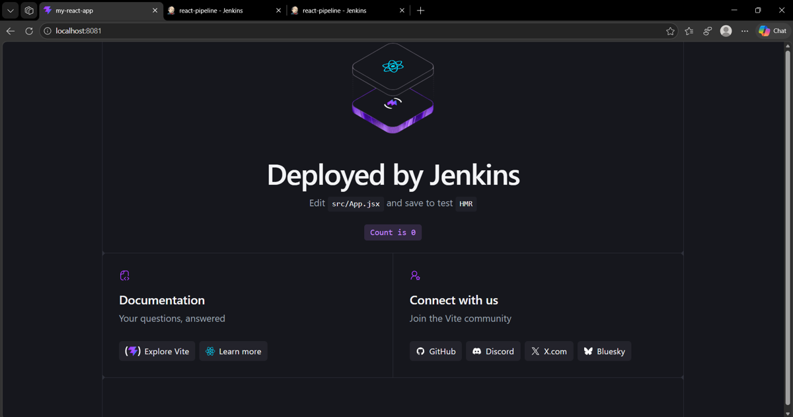
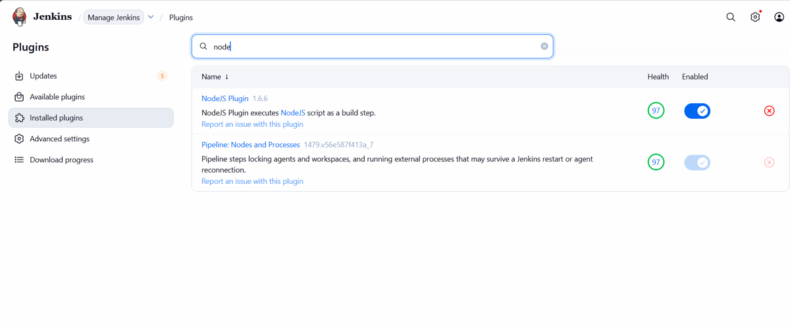
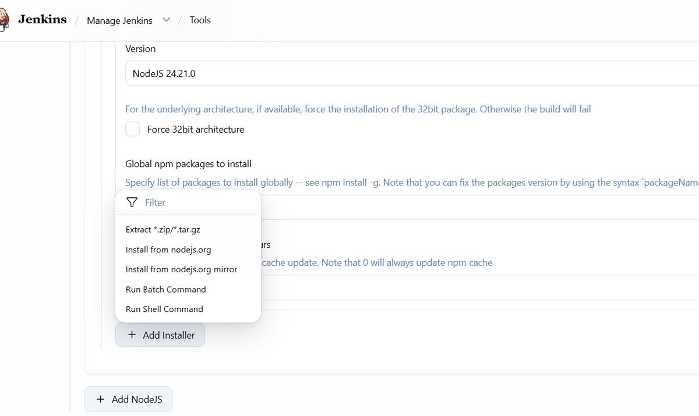
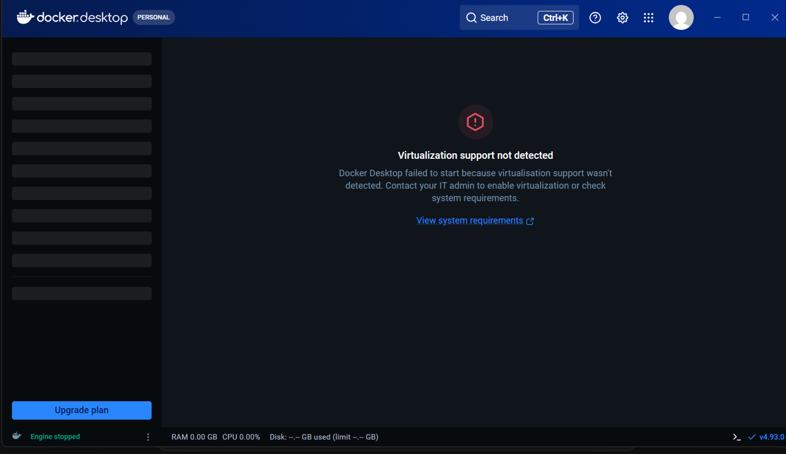

# CI/CD Pipeline with Jenkins, Docker and Nginx

An automatic build and deploy pipeline for a React (Vite) app. When I push code to GitHub, Jenkins detects the change, builds the app with Node.js, and deploys it to an Nginx web server. No manual steps after `git push`.

## How it works

```
Edit code -> git push -> GitHub -> Jenkins (Poll SCM) -> npm install -> npm run build -> copy dist/ -> Nginx (localhost:8081)
```

| Part | Role |
|---|---|
| React + Vite | The website being delivered |
| GitHub | Stores the code and the `Jenkinsfile` |
| Jenkins (Docker) | Runs the pipeline stages |
| NodeJS plugin | Gives Jenkins Node.js and npm |
| Nginx (Docker) | Serves the built files |
| Docker volumes | `jenkins_home` keeps Jenkins data, `site_html` is shared between Jenkins and Nginx |

## Pipeline stages (`Jenkinsfile`)

1. **Check Tools**: print Node and npm versions
2. **Install**: `npm install`
3. **Build**: `npm run build` (creates `dist/`)
4. **Deploy**: copy `dist/` into the folder Nginx serves

## Run it yourself

Requirements: Docker Desktop, Git, a GitHub repo with this code.

```bash
# 1. Web server (Nginx) on port 8081
docker run -d --name webserver -p 8081:80 -v site_html:/usr/share/nginx/html nginx:alpine

# 2. Jenkins on port 8080, sharing the same site folder
docker run -d --name jenkins -p 8080:8080 -p 50000:50000 \
  -v jenkins_home:/var/jenkins_home -v site_html:/var/www/site jenkins/jenkins:lts
docker exec -u root jenkins chown -R jenkins:jenkins /var/www/site
```

Then in Jenkins (`http://localhost:8080`):

1. Install the **NodeJS** plugin.
2. Manage Jenkins, Tools, add a NodeJS installation named `node24` (version 24.x).
3. Create a **Pipeline** job: Pipeline script from SCM, Git, this repo URL, branch `*/main`, Script Path `Jenkinsfile`.
4. Build Triggers: tick **Poll SCM**, schedule `* * * * *`.

Push a change and open `http://localhost:8081` to see the new version.

## Proof it works

Jenkins started the build by itself after my push:



Build finished successfully:



The site served by Nginx before and after my change:




<!-- Add later:  and  -->

Setup screenshots:




## Problems I faced and how I fixed them

| Problem | Why it happened | Fix |
|---|---|---|
| Docker: "Virtualization support not detected" | Windows features for WSL 2 were not ready | Enable Virtual Machine Platform and WSL, `wsl --update`, restart |
| WSL installation corrupted | Damaged WSL component | Let `wsl --update` repair it |
| `Cannot run program "cmd"` in Jenkins | Jenkins runs in a Linux container, no Windows `cmd` | Use "Execute shell" (`sh`) |
| `node: not found` | Node tool was not attached to the job | NodeJS plugin, tool `node24`, `tools { nodejs 'node24' }` |
| `pathspec 'Jenkinsfile' did not match` | Notepad saved `Jenkinsfile.txt` | `ren Jenkinsfile.txt Jenkinsfile` |
| `Author identity unknown` | Git did not know my name and email | `git config --global user.name` and `user.email` |
| `remote origin already exists` | Placeholder URL was added earlier | `git remote set-url origin <real url>` |
| `port is already allocated` | Laptop port already used | Change the left side of `-p`, for example `8081:80` |
| Build did not start after push | Poll SCM not enabled or saved | Tick Poll SCM, schedule `* * * * *`, Save |
| `docker ps` empty after restart | Docker Desktop was off, containers stopped | `docker start jenkins` (data is safe in the volume) |

Full list with screenshots: 

## What I learned

- CI/CD flow: commit, build, test, deploy, and why automation reduces mistakes.
- Pipeline as code: stages live in a `Jenkinsfile` in the repo.
- Docker: images, containers, volumes, and port mapping (`-p LAPTOP:CONTAINER`).
- Reading Console Output: start from the bottom to find the failing command.
- Poll SCM vs webhook: webhooks are instant but need a public URL, so localhost needs a tunnel like ngrok.

## Limitations and next steps

- Runs on my laptop, not on a production server.
- Poll SCM checks every minute; a webhook (with ngrok) would be instant.
- Deploy copies files through a shared Docker volume; the next step is deploying to another machine over SSH with Jenkins Credentials.
- Add lint and test stages, failure notifications, and an AI step that explains failed builds.
